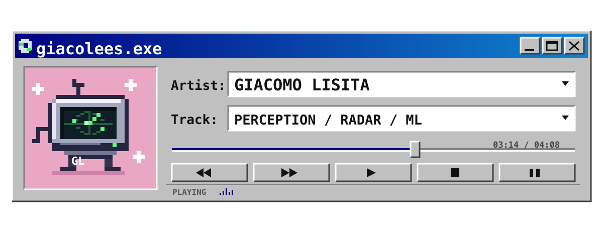

Research engineer, M.Sc. in Computer Engineering, working across multi-sensor perception, radar ML, and LLM applications.

Research interests:
- Multi-sensor perception
- Machine learning for radar
- LLM applications

Tools: Python, C++, C, PyTorch · MLOps · Data engineering

[LinkedIn](https://linkedin.com/in/giacomolisita) · [X](https://x.com/TechLees_)
